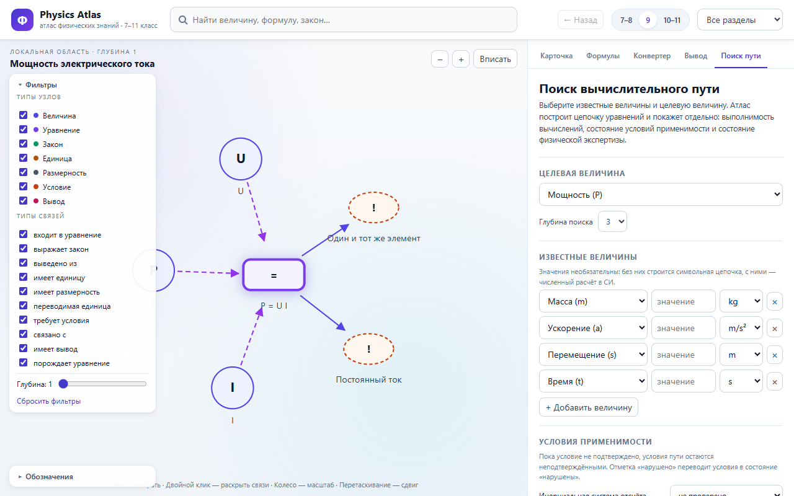

# Physics Atlas

Интерактивный атлас школьных физических знаний для 7–11 классов. В центре продукта — один типизированный
граф физических величин, уравнений, законов, единиц, размерностей, условий применимости и выводов, а не
набор отдельных формул.

Атлас помогает исследовать связи и строить вычислительные цепочки: выбрать известные величины, указать
целевую величину и увидеть, какими уравнениями она выражается, какие условия при этом должны выполняться,
выполнимы ли вычисления и как обстоит дело с физической экспертизой. Это три независимых ответа, а не
один «допустимый» вердикт.

**Что это не так.** Это не учебник, не LMS, не симулятор и не виртуальная лаборатория. В MVP намеренно нет
лабораторий, экспериментов, курсов, тестов, профилей, бэкенда и авторизации.

> **Статус физической экспертизы.** У каждой записи разделены происхождение формулировки («стандартная
> школьная запись», «определение», «производная форма», «черновик») и состояние экспертизы («не
> проводилась», «запрошена», «проведена», «отклонена»). Ни одна запись в базе не имеет завершённой
> экспертизы; атлас не выдаёт размерностную проверку за доказательство корректности. Подробности — в
> [docs/content-status.md](docs/content-status.md).
>
> **Вы преподаватель физики?** Пошаговая инструкция — в разделе
> [«Проверка экспертом-физиком»](#проверка-экспертом-физиком) ниже: что скачать, какие файлы
> открыть и как отправить правки.

## Что реализовано

- **Карта знаний**: локальная окрестность выбранного объекта, панорама и масштаб, раскрытие связей,
  фильтры по типам узлов и рёбер, подсветка вычислительного маршрута.
- **Карточки** для всех семи типов объектов: величина, уравнение, закон, единица, размерность, условие,
  вывод. Уравнения показывают LaTeX и AST, раздельные статусы структуры, размерностей, формулировки,
  экспертизы и условий.
- **Поиск** по названию, символу, альтернативному названию и формуле (`F = ma`, `v=s/t`).
- **Школьные уровни** 7–8, 9, 10–11 на одном каноническом объекте (разные изложения, а не копии).
- **Обозреватель формул**: состав, переменные, связанные законы, допустимые формы, AST.
- **Конвертер единиц** с проверкой размерности и физической группы величин (совпадение размерности не
  делает величины взаимозаменяемыми).
- **Вывод формулы**: шаги преобразований, ограничения, структурная проверка совпадения с целевым уравнением.
- **Поиск вычислительного пути**: цепочки с отдельными характеристиками «вычисления / условия /
  экспертиза», ранжированием, привязкой каждого условия к требующему его уравнению или закону и
  необязательным численным расчётом в СИ.
- **Исследование**: история выбранных объектов с кнопкой «Назад», объяснение расстояния до узла и
  направления связей; введённые данные поиска пути сохраняются при переключении вкладок.
- **База знаний**: 77 сущностей, 130 производных связей, 2 раздела (механика и электричество), 11 уравнений,
  4 вывода. Проверяется схемами и семантическими правилами (`pnpm validate`).

## Как это выглядит

Снимки сделаны с production-сборки в браузере.




## Быстрый старт

Требуется Node.js ≥ 22.18 (проверено на 24.21) и pnpm 11.

```bash
pnpm install
pnpm dev          # http://localhost:5173
```

Проверки:

```bash
pnpm validate     # схема, ссылки, AST, размерности, выводы
pnpm typecheck    # tsc --noEmit
pnpm test         # Vitest, 159 тестов
pnpm build        # валидация + production-сборка
pnpm preview      # просмотр собранной версии
```

В этом окружении `node` и `pnpm` поставляются отдельным runtime-каталогом, а pnpm-store размещён внутри
проекта (`pnpm-workspace.yaml`, `storeDir`), потому что песочница запрещает запись в глобальный store.
Если `pnpm` недоступен в `PATH`, команды запускаются через явный путь к `node` и `pnpm.mjs` из runtime.

## Проверка экспертом-физиком

Этот раздел — для преподавателя физики, который проверит достоверность и полноту базы знаний.
Программировать не нужно. Вы меняете только тексты, условия, единицы, источники и отметки о
проверке в JSON-файлах. Код, AST и математическую структуру формул без разработчика не трогайте.

> **Главное правило.** `review.expert: completed` ставится только за конкретную проверенную запись
> и только когда у неё есть имя рецензента, дата и источник. Совпадение размерностей или удачный
> расчёт не заменяют физическую экспертизу. Если сомневаетесь — оставьте `expert: none` и напишите
> об этом в pull request.

### Что проверять

1. **Физический смысл и форма.** Скаляр или вектор, модули или проекции; не выдаёт ли запись
   частный случай за общий закон.
2. **Условия применимости.** Полнота условий, правильная привязка к уравнению или закону, отсутствие
   потерянных ограничений.
3. **Изложения для уровней 7–8, 9 и 10–11.** Один объект должен иметь три разных изложения, но не
   терять важные условия ради упрощения.
4. **Единицы и размерности.** Коэффициенты, смещения, группы конвертации; одинаковые размерности
   не означают взаимозаменяемость величин.
5. **Источники.** Реальные издания и страницы; не выдумывать ISBN, страницы и цитаты.

### Что скачать и откуда взять файлы

Репозиторий: <https://github.com/ilux-git/PhysicsAtlas>. Основная ветка — `main`.

- **GitHub Desktop** — <https://desktop.github.com/>. Удобен для новичка: клонирует репозиторий,
  показывает изменения и отправляет их на GitHub.
- **VS Code** — <https://code.visualstudio.com/>. Текстовый редактор с подсветкой JSON; бесплатный.
- **Node.js** — <https://nodejs.org/> (версия 22.18 или новее). Нужен только для локальных проверок;
  без него можно подготовить правки и попросить разработчика запустить проверку.
- **pnpm** отдельно скачивать не нужно: после установки Node выполните `corepack enable`.

Если не хотите устанавливать программы, есть два облегчённых пути: править файлы на сайте GitHub
(нужен аккаунт) или скачать ZIP и отправить исправленные файлы обратно (аккаунт не нужен).

### Вариант 1. GitHub Desktop + VS Code (рекомендуется)

1. Установите GitHub Desktop и VS Code. В GitHub Desktop войдите в свой аккаунт GitHub.
2. Если репозиторий приватный, примите приглашение от владельца проекта. Без приглашения клонировать
   приватный репозиторий нельзя.
3. В GitHub Desktop: **File → Clone repository → URL** и вставьте
   `https://github.com/ilux-git/PhysicsAtlas.git`. Выберите папку на компьютере и нажмите **Clone**.
4. Перед работой получите последнюю версию: **Fetch origin**, затем **Pull origin**. Если кнопки нет,
   ветка уже актуальна.
5. Создайте отдельную ветку: **Current branch → New branch**, имя вида `review/physics-2026-11`.
   Не работайте в `main`.
6. В GitHub Desktop: **Repository → Open in VS Code**. В VS Code откройте нужный файл из
   `src/knowledge/data/` (список ниже).
7. Отредактируйте текст, условия, источники и поля `review`. Сохраните файл. Кодировка — UTF-8;
   не редактируйте JSON в Word или Google Docs.
8. В GitHub Desktop проверьте список изменений, напишите короткое сообщение (например,
   `review: проверил P=UI и условия постоянного тока`) и нажмите **Commit to review/...**.
9. Нажмите **Push origin**. Затем **Create Pull Request** (или откройте ссылку для сравнения из
   раздела «Как отправить работу»).
10. Не нажимайте **Merge**, пока изменения не проверены и не одобрены.

Если у вас нет прав записи в основной репозиторий, сначала нажмите **Fork** на странице GitHub,
клонируйте свой форк и создайте pull request из форка в `main` основного репозитория. Для приватного
репозитория форк недоступен — попросите приглашение.

### Вариант 2. Только браузер GitHub

Нужен аккаунт GitHub. Если репозиторий приватный, попросите приглашение.

1. Откройте <https://github.com/ilux-git/PhysicsAtlas>.
2. Если у вас есть право записи: сначала создайте ветку. Нажмите на переключатель веток, введите
   `review/physics-2026-11` и выберите **Create branch: review/... from main**. Не коммитьте в `main`.
3. Откройте файл в `src/knowledge/data/`, нажмите карандаш **Edit**, внесите правку и нажмите
   **Commit changes** в эту ветку. Повторите для остальных файлов.
4. После коммитов нажмите **Compare & pull request** или **Contribute → Open pull request**. База —
   `main`, сравнение — ваша ветка.
5. Если права записи нет: нажмите **Fork**, в своём форке создайте ветку, внесите правки и предложите
   pull request в `main` основного репозитория.

Встроенный редактор GitHub не проверяет физику и не всегда ловит ошибки JSON. Запятые и кавычки
проверяйте особенно внимательно; лучше скачать ZIP и открыть файл в VS Code.

### Вариант 3. Совсем без GitHub: ZIP

1. На странице репозитория нажмите **Code → Download ZIP** и распакуйте архив.
2. Откройте папку в VS Code (или другом текстовом редакторе, сохраняющем UTF-8). Не используйте Word.
3. Внесите правки в JSON-файлы по инструкции ниже.
4. Отправьте архив или исправленные файлы тем же способом, которым получили задание, с коротким
   описанием: что проверено, какие источники использованы, что осталось под сомнением. Если проверка
   не запускалась, так и напишите.
5. При следующей итерации скачайте свежий ZIP заново: у ZIP нет команды «получить последние изменения».

### Какие файлы менять

Все данные лежат в `src/knowledge/data/`. Не меняйте код в `src/engines`, `src/domain`, `src/ui` и
конфигурационные файлы — для этого нужен разработчик.

| Файл | Что можно исправить | Осторожно |
|---|---|---|
| `equations.json` | описание, `conditionRefs`, `form.note`, поля `review` | `lhsAst`, `rhsAst`, `displayLatex` — только с разработчиком: валидатор требует их согласованности |
| `conditions.json` | название, описание, `structured`, изложения уровней, `review` | ID условий используются в уравнениях; не удаляйте и не переименовывайте их без обновления ссылок |
| `quantities.json` | определение, изложения уровней, список единиц, `review` | `dimensionId` и символ величины меняйте только с разработчиком |
| `laws.json` | описание, `conditionRefs`, изложения уровней, `review` | те же правила для ID условий |
| `derivations.json` | шаги, предусловия, `review` | `verificationStatus` бывает только `draft` или `structural`; «verified» не принимается |
| `units.json` | коэффициент, смещение, группу — только если вы уверены | изменение коэффициента влияет на все переводы |
| `dimensions.json` | показатели размерности — только с разработчиком | влияет на все размерностные проверки |
| `sources.json` | реальные библиографические записи | не выдумывайте страницы, ISBN и цитаты |

Уравнения не имеют отдельных изложений по классам: уровни задаются у величин, законов и условий.
Всего в базе 11 уравнений, 14 условий, 12 величин, 2 закона и 4 вывода; начинать с уравнения и его
условий полезнее, чем пытаться проверить всё сразу.

### Как отметить проверку в JSON

В каждой сущности есть блок `review`. До проверки он выглядит так:

```json
"review": { "formulation": "standard-school", "expert": "none" },
```

После реальной проверки — например, для уравнения:

```json
"review": {
  "formulation": "standard-school",
  "expert": "completed",
  "reviewer": "И. И. Иванов, кафедра физики, школа № 1",
  "reviewedAt": "2026-11-26"
},
```

Правила:

- `formulation` оставьте как есть, если вы не исправляете сам тип записи
  (`standard-school`, `definition`, `derived`, `draft`);
- `expert` меняйте на `completed` только для конкретной проверенной сущности;
- `reviewer` — имя и организация; `reviewedAt` — строго формат `ГГГГ-ММ-ДД`;
- у сущности должен быть хотя бы один источник: массив `sources` не должен быть пустым, а его ID
  должны существовать в `sources.json`;
- `rejected` требует причину в `review.note`: `{ "ru": "Почему запись отклонена" }`;
- если вы проверяли уравнение, но не проверяли его условия, не отмечайте уравнение завершённым:
  условия — отдельные сущности и проверяются отдельно.

Если нужен новый источник, сначала добавьте его в `sources.json`. Ниже — пример структуры;
замените вымышленные данные на настоящие:

```json
{
  "id": "source.example-2026",
  "type": "textbook",
  "title": "Физика. 9 класс",
  "authors": "А. В. Примеров",
  "edition": "2-е изд. — М.: Издательство, 2026",
  "note": { "ru": "Страницы 42–45 проверены рецензентом" }
}
```

ID должен быть уникальным и осмысленным; `url` добавляйте только если адрес настоящий, иначе
поле можно не указывать. После этого добавьте ID в `sources` проверяемой сущности.

### Полный список формул

| ID | Формула | Текущие условия | Что проверить |
|---|---|---|---|
| `eq.newton2.magnitudes` | `F = m a` | `cond.inertial-frame`, `cond.constant-mass` | инерциальная система; постоянная масса; запись через модули и направление |
| `eq.newton2.acceleration` | `a = F/m` | `cond.inertial-frame`, `cond.constant-mass`, `cond.nonzero-mass` | масса не равна нулю; это производная форма |
| `eq.work.constant-force` | `A = F s` | `cond.constant-force`, `cond.force-along-displacement` | сила постоянна и направлена вдоль перемещения; не универсальная формула |
| `eq.work.force` | `F = A/s` | `cond.constant-force`, `cond.force-along-displacement`, `cond.nonzero-displacement` | перемещение не равно нулю; производная форма |
| `eq.power.average` | `P = A/t` | `cond.nonzero-time` | средняя мощность за интервал; `t ≠ 0` |
| `eq.power.time` | `t = A/P` | `cond.nonzero-power` | мощность не равна нулю; производная форма |
| `eq.velocity.uniform` | `v = s/t` | `cond.uniform-motion`, `cond.nonzero-time` | равномерное движение; средняя скорость для неравномерного не моделируется отдельно |
| `eq.ohm.local` | `U = I R` | `cond.ohmic-element`, `cond.constant-resistance` | омический элемент; постоянное сопротивление |
| `eq.ohm.current` | `I = U/R` | `cond.ohmic-element`, `cond.constant-resistance`, `cond.nonzero-resistance` | сопротивление не равно нулю; производная форма |
| `eq.charge.current` | `Q = I t` | `cond.steady-current` | постоянный ток; для переменного нужен интеграл |
| `eq.power.electric` | `P = U I` | `cond.same-element`, `cond.steady-current` | постоянный ток; средняя мощность в цепи переменного тока не моделируется |

Проверьте также четыре вывода: `der.newton2.acceleration`, `der.work.force`, `der.power.time`,
`der.ohm.current`. Для них важны шаги и предусловия. Сейчас у всех четырёх `verificationStatus:
structural` — это структурная проверка, а не символьное доказательство. Значение `verified` в этой
версии недопустимо; отметка о вашей экспертизе ставится в `review`, а не в `verificationStatus`.

### Как запустить проверку (необязательно)

Если установлены Node.js 22.18+ и pnpm, в папке проекта выполните:

```bash
node --version
corepack enable
pnpm install
pnpm validate
```

Успех выглядит так: `Проверка пройдена.` и `Ошибок: 0`. Если `pnpm` не найден после `corepack enable`,
перезапустите терминал; если `corepack` в вашей версии Node отсутствует, попробуйте
`npm install -g pnpm@11` (может потребоваться разрешение администратора). Если установить инструменты
не получается — пропустите этот шаг и укажите в pull request: «проверку не запускал(а)».

Проверка ловит ошибки схемы, ссылок, JSON, размерностей и отображений. Она **не** проверяет
физическую корректность — это ваша работа. Полные тесты и сборку запускает разработчик.

При желании можно открыть приложение: `pnpm dev`, затем <http://localhost:5173>, найти формулу или
величину поиском и посмотреть карточку и уровни. Это помогает, но не заменяет проверку текста.

### Как отправить работу

Если вы работаете через GitHub Desktop или сайт, откройте pull request из вашей ветки в `main`.
Ссылку можно открыть вручную:

```text
https://github.com/ilux-git/PhysicsAtlas/compare/main...review/physics-2026-11?expand=1
```

Для форка добавьте имя аккаунта: `main...<ваш-логин>:review/physics-2026-11`. В заголовке напишите,
что проверено, например: `Проверка: F = ma, A = Fs, P = UI`. В описании используйте шаблон:

```text
Проверено: <ID сущностей>
Источники: <точные издания и страницы>
Сомнения: <что осталось под вопросом>
Не проверено: <что пропущено>
```

Не нажимайте **Merge** самостоятельно: изменения должны пройти проверку. Если вы отправили ZIP,
приложите к сообщению тот же текст.

### Чек-лист

- [ ] Физический смысл и форма (скаляр/вектор) проверены.
- [ ] Условия применимости полны и привязаны к нужному уравнению/закону.
- [ ] Изложения 7–8, 9 и 10–11 не теряют ограничений.
- [ ] Единицы и размерности согласованы.
- [ ] Источники реальные, указывают издание/страницы и добавлены в `sources`.
- [ ] `review.expert: completed` стоит только у проверенных сущностей.
- [ ] AST/`displayLatex`/код не менялись без разработчика.
- [ ] `pnpm validate` запущен или явно указано, что он не запускался.

### Если что-то не получается

- **`schema-invalid`** — ошибка JSON: лишняя/пропущенная запятая, кавычка или неверное поле. VS Code
  подчёркивает синтаксис; вернитесь к последней рабочей версии, если не удаётся найти ошибку.
- **`ref-missing`** — ссылка на несуществующий ID источника или условия. Используйте существующий ID
  или добавьте запись в `sources.json`/`conditions.json`.
- **`review-incomplete`** — у `completed` нет рецензента, даты или источника. Заполните их или
  верните `expert: none`.
- **`display-ast-mismatch`** — текстовая формула и AST разошлись. Верните `displayLatex` или
  попросите разработчика изменить AST и представление вместе.
- **`dimension-mismatch`** — изменилась структура формулы или размерность. Не «подгоняйте» цифры;
  верните изменение и обсудите с разработчиком.
- **GitHub Desktop показывает конфликт** — остановитесь, не делайте force-push и не удаляйте
  изменения; напишите разработчику.

<details>
<summary>Словарь GitHub для новичка</summary>

- **Репозиторий** — папка проекта на GitHub вместе с историей изменений.
- **Клонировать** — скачать репозиторий на компьютер так, чтобы можно было отправлять изменения.
- **Pull** — получить изменения, сделанные другими, в свою копию.
- **Ветка** — отдельная линия изменений; ваша работа не попадает в `main` сразу.
- **Commit** — сохранённый набор изменений с сообщением.
- **Push** — отправить свои коммиты на GitHub.
- **Pull request (PR)** — предложение влить вашу ветку в `main`, где изменения можно обсудить.
- **Fork** — личная копия чужого репозитория на GitHub, из которой можно предложить PR.
- **`main`** — основная ветка; не коммитьте в неё напрямую.
- **Issue** — обсуждение или сообщение об ошибке на GitHub.

</details>

## Структура проекта

```text
src/
  domain/        типы, Zod-схемы, работа с AST и текстом
  knowledge/     JSON-база знаний, загрузка, производные рёбра, валидатор
  engines/       размерности и единицы, AST, граф, поиск, вычислительные пути
  ui/            карта, карточки, поиск, инструменты
  app/           состояние, URL-hash, сборка экрана
scripts/         validate-kb.ts — проверка базы знаний
docs/            архитектура, схема данных, AST, связи, движок, статус контента
```

## Данные и источник истины

Физические факты хранятся только в `src/knowledge/data/*.json`. Рёбра графа, списки переменных уравнения,
обратные ссылки законов и поисковый индекс **выводятся** при загрузке, а не дублируются в JSON. Поэтому
карточка, карта и поиск не могут разойтись с базой знаний.

## Документация

- [Аудит 2026-11-22 и найденные проблемы](docs/audit-2026-11-22.md)
- [План надёжности PROMPT-2](docs/plan-prompt-2.md)
- [План и критерии приёмки](docs/plan.md)
- [Архитектура](docs/architecture.md)
- [Схема базы знаний](docs/knowledge-schema.md)
- [AST и математика](docs/ast.md)
- [Связи графа](docs/graph-relations.md)
- [Математический движок](docs/math-engine.md)
- [Статус контента и ограничения](docs/content-status.md)
- [Предложение по кинематике (только план)](docs/content-plan-kinematics.md)
- [Принятые архитектурные решения](docs/decisions.md)

## Известные ограничения (полный список — в docs/content-status.md)

- Интерфейс только на русском; поля локализации (`ru`/`en`) есть, английское покрытие частичное.
- Физическая экспертиза контента не завершена: у всех записей `expert: none`; источники — вехи охвата,
  а не постраничная библиография. Внешняя сверка источников 22.11.2026 была недоступна.
- Решатель ограничен одним вхождением величины. `x² = c` не решается выбором одного корня: возвращается
  `multiple-solutions`; степени, кроме первой, не инвертируются. Символического CAS нет.
- Векторные величины рассматриваются как модули; векторной алгебры нет. `P = UI` в атласе ограничена
  постоянным током: средняя мощность в цепи переменного тока не моделируется.
- Единицы со смещением (°C/K) поддерживаются движком и тестами, но в контент не добавлены.
- Состояние и черновик поиска пути живут в текущей сессии; после перезагрузки остаётся только hash-ссылка.
- Сборка — один бандл ≈ 214 КБ gzip (KaTeX и база знаний включены).

## Ветка

`main` — основная ветка с текущим состоянием проекта. Изменения вносятся через отдельные ветки и
pull request; не коммитьте напрямую в `main`.