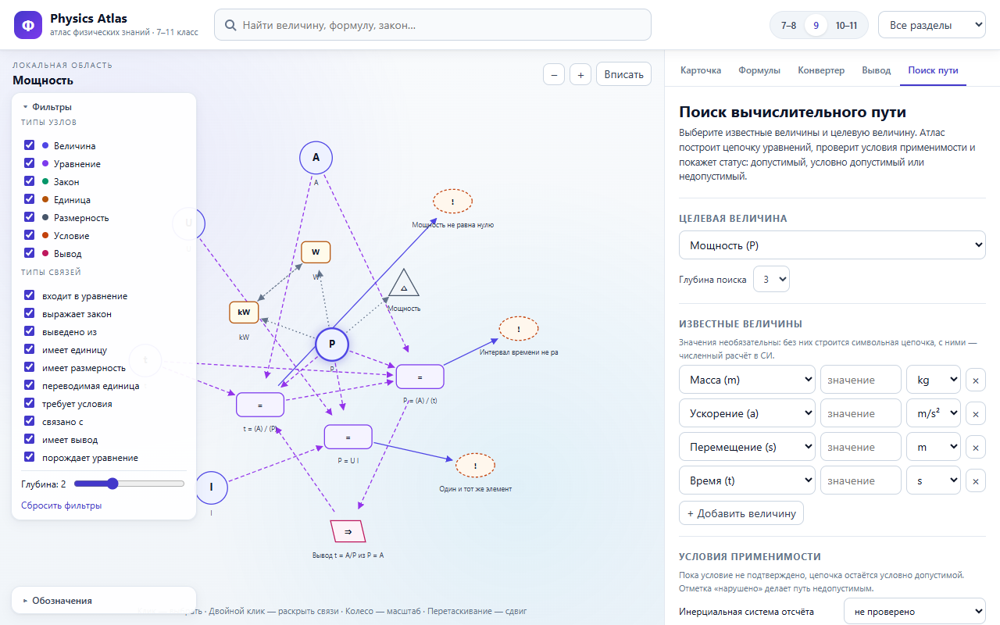
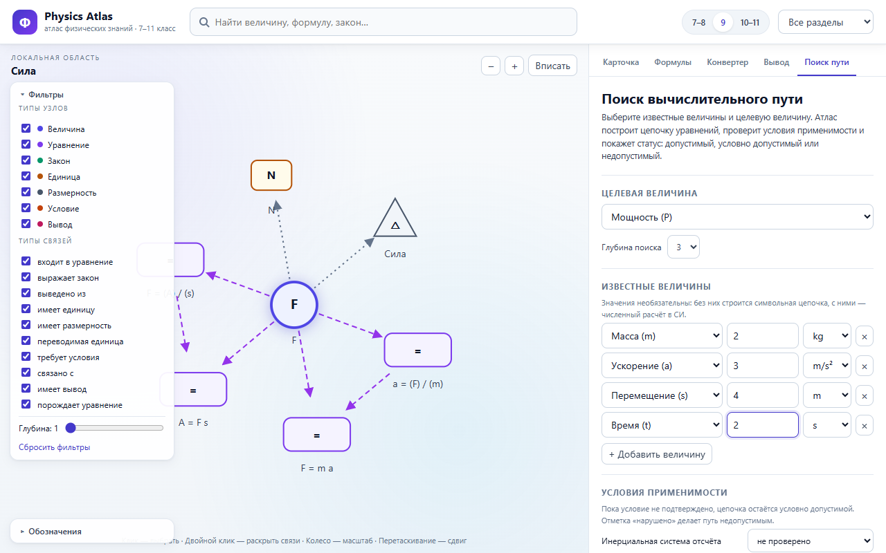

# Physics Atlas

Интерактивный атлас школьных физических знаний для 7–11 классов. В центре продукта — один типизированный
граф физических величин, уравнений, законов, единиц, размерностей, условий применимости и выводов, а не
набор отдельных формул.

Атлас помогает исследовать связи и строить вычислительные цепочки: выбрать известные величины, указать
целевую величину и увидеть, какими уравнениями она выражается, какие условия при этом должны выполняться
и в каком месте цепочка становится недопустимой.

**Что это не так.** Это не учебник, не LMS, не симулятор и не виртуальная лаборатория. В MVP намеренно нет
лабораторий, экспериментов, курсов, тестов, профилей, бэкенда и авторизации.

> **Статус физической экспертизы.** Формулы помечены как «стандартная школьная формулировка». Независимая
> физическая рецензия не проводилась; атлас не выдаёт размерностную проверку за доказательство
> корректности. Подробности — в [docs/content-status.md](docs/content-status.md).

## Что реализовано

- **Карта знаний**: локальная окрестность выбранного объекта, панорама и масштаб, раскрытие связей,
  фильтры по типам узлов и рёбер, подсветка вычислительного маршрута.
- **Карточки** для всех семи типов объектов: величина, уравнение, закон, единица, размерность, условие,
  вывод. Уравнения показывают LaTeX и AST, четыре независимых статуса проверки.
- **Поиск** по названию, символу, альтернативному названию и формуле (`F = ma`, `v=s/t`).
- **Школьные уровни** 7–8, 9, 10–11 на одном каноническом объекте (разные изложения, а не копии).
- **Обозреватель формул**: состав, переменные, связанные законы, допустимые формы, AST.
- **Конвертер единиц** с проверкой размерности и физической группы величин (совпадение размерности не
  делает величины взаимозаменяемыми).
- **Вывод формулы**: шаги преобразований, ограничения, структурная проверка совпадения с целевым уравнением.
- **Поиск вычислительного пути**: цепочки с ранжированием, статусами «допустимый / условно допустимый /
  недопустимый», учётом условий и необязательным численным расчётом в СИ.
- **База знаний**: 77 сущностей, 129 производных связей, 2 раздела (механика и электричество), 11 уравнений,
  4 вывода. Проверяется схемами и семантическими правилами (`pnpm validate`).

## Как это выглядит

Снимки сделаны с production-сборки в браузере.





## Быстрый старт

Требуется Node.js ≥ 22.18 (проверено на 24.21) и pnpm 11.

```bash
pnpm install
pnpm dev          # http://localhost:5173
```

Проверки:

```bash
pnpm validate     # схема, ссылки, AST, размерности, выводы
pnpm typecheck    # tsc --noEmit
pnpm test         # Vitest, 119 тестов
pnpm build        # валидация + production-сборка
pnpm preview      # просмотр собранной версии
```

В этом окружении `node` и `pnpm` поставляются отдельным runtime-каталогом, а pnpm-store размещён внутри
проекта (`pnpm-workspace.yaml`, `storeDir`), потому что песочница запрещает запись в глобальный store.
Если `pnpm` недоступен в `PATH`, команды запускаются через явный путь к `node` и `pnpm.mjs` из runtime.

## Структура проекта

```text
src/
  domain/        типы, Zod-схемы, работа с AST и текстом
  knowledge/     JSON-база знаний, загрузка, производные рёбра, валидатор
  engines/       размерности и единицы, AST, граф, поиск, вычислительные пути
  ui/            карта, карточки, поиск, инструменты
  app/           состояние, URL-hash, сборка экрана
scripts/         validate-kb.ts — проверка базы знаний
docs/            архитектура, схема данных, AST, связи, движок, статус контента
```

## Данные и источник истины

Физические факты хранятся только в `src/knowledge/data/*.json`. Рёбра графа, списки переменных уравнения,
обратные ссылки законов и поисковый индекс **выводятся** при загрузке, а не дублируются в JSON. Поэтому
карточка, карта и поиск не могут разойтись с базой знаний.

## Документация

- [План и критерии приёмки](docs/plan.md)
- [Архитектура](docs/architecture.md)
- [Схема базы знаний](docs/knowledge-schema.md)
- [AST и математика](docs/ast.md)
- [Связи графа](docs/graph-relations.md)
- [Математический движок](docs/math-engine.md)
- [Статус контента и ограничения](docs/content-status.md)
- [Принятые архитектурные решения](docs/decisions.md)

## Известные ограничения (полный список — в docs/content-status.md)

- Интерфейс только на русском; поля локализации (`ru`/`en`) есть, английское покрытие частичное.
- Физическая экспертиза контента не завершена; источники — вехи охвата, а не постраничная библиография.
- Решатель ограничен одним вхождением величины; степени, отличные от 1 и 2, не инвертируются; символического
  CAS нет.
- Векторные величины рассматриваются как модули; векторной алгебры нет.
- Единицы со смещением (°C/K) поддерживаются движком и тестами, но в контент не добавлены.
- Состояние не сохраняется между сессиями; бэкенда и аккаунтов нет.
- Сборка — один бандл ≈ 200 КБ gzip (KaTeX и база знаний включены).

## Ветка

Работа ведётся в `feat/physics-atlas-mvp`; `main` содержит только исходный `PROMPT.md` и правила репозитория.